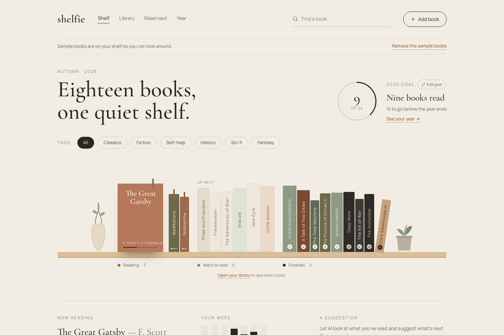
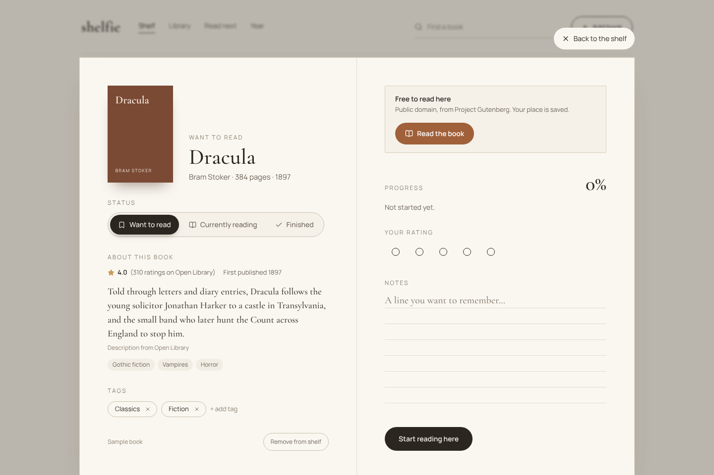
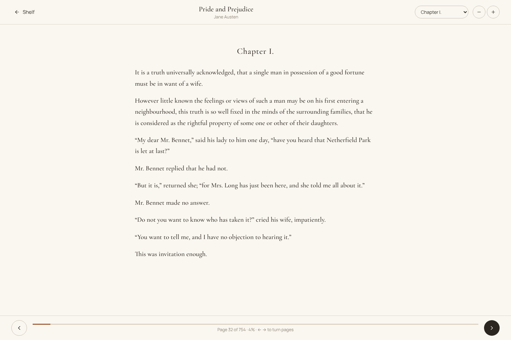
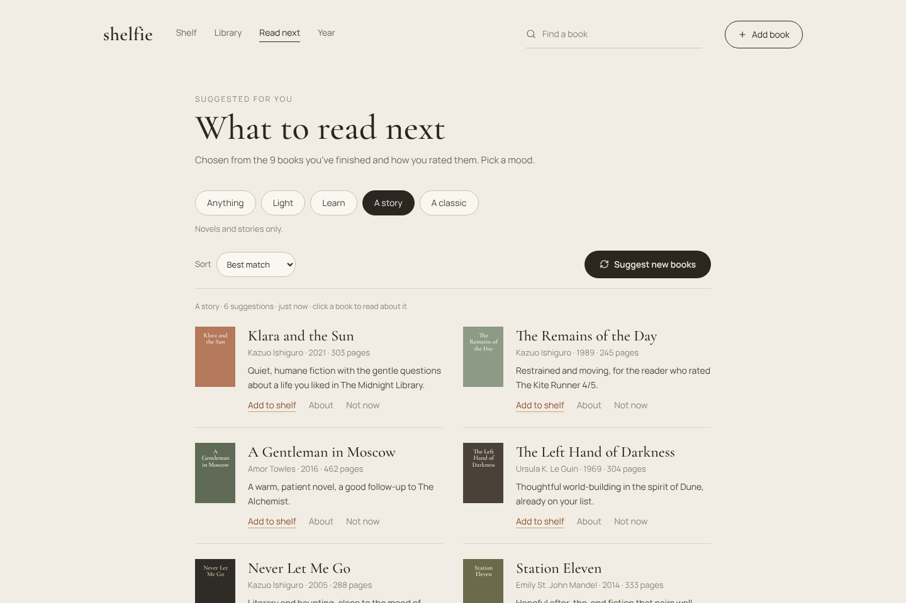
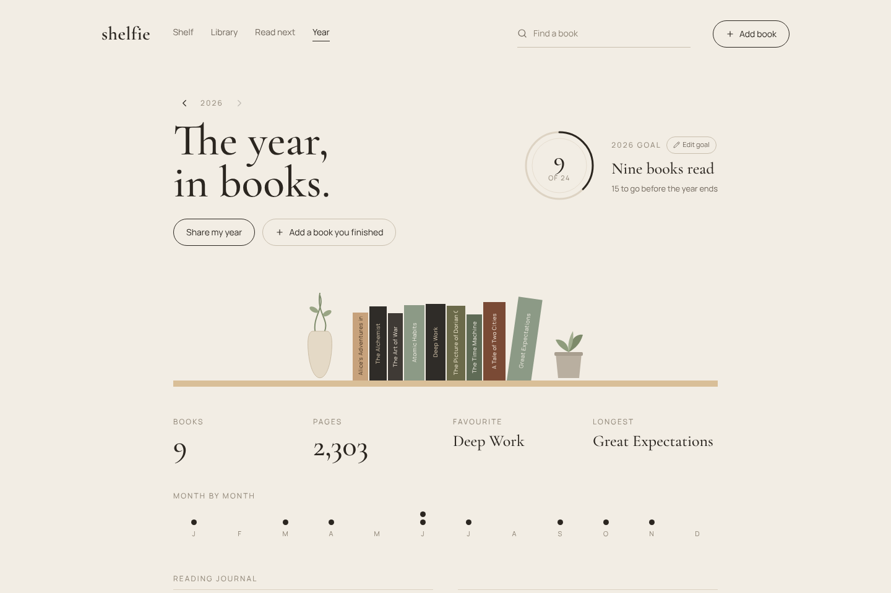
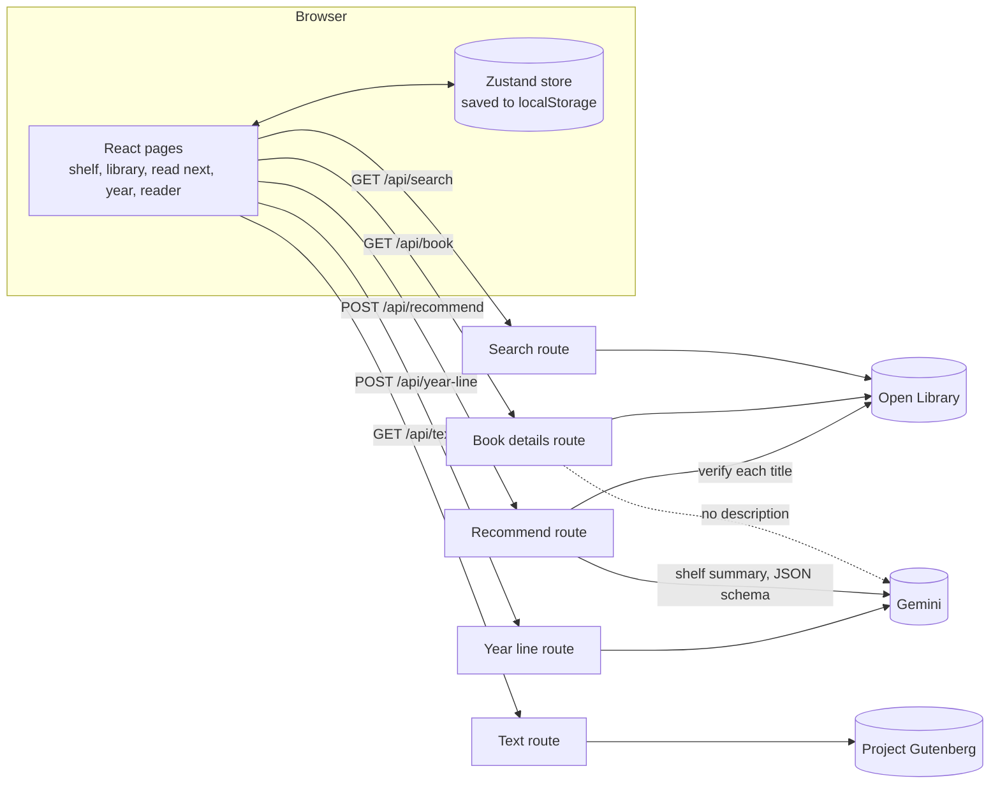

# Shelfie

A calm reading shelf in the browser. Every book sits on one oak shelf: what you're reading, what you want to read and what you've finished, each easy to tell apart. Read public-domain classics inside the app, track progress and a reading streak, follow a goal for each year, read about any book, and let a small AI helper suggest real books to read next.

**Live:** _add your Vercel link here_



| Book opened                                 | Reading a free classic                     |
| ------------------------------------------- | ------------------------------------------ |
|       |       |
| **Read next (AI)**                          | **Your year**                              |
|  |  |

## Features

**A complete loop:** welcome → set a goal → add books → read → finish → rate → get suggestions → add the next one.

- **Welcome flow.** First-time visitors choose between starting their own shelf in three short steps (yearly goal, books they've loved, what they're reading next) or looking around a clearly labelled sample shelf. Most sample books are public-domain classics, so "Continue reading" works straight away.
- **One shelf, three kinds of book.** Reading books come first: the current one faces out with its cover, and each has a bookmark ribbon and a progress line. Want-to-read books are pale, with "Up next" over the first. Finished books are deep-toned with a small tick. Spine colour, height and width come from each book's title and page count, so a book always looks the same.
- **The shelf never overflows.** It holds only what fits between the vase and the pot, sharing the space between the three groups. The rest is counted as "+N more" and every book is in the **Library** page, with filters, search and sorting.
- **Read inside the app.** Public-domain books (found through Open Library's Project Gutenberg links) open in a quiet full-screen reader: pages sized to the screen, chapter jump, text size, arrow keys or swipe, and your place is saved. Turning pages moves the book's progress forward. Books still in copyright link honestly to Open Library to borrow instead.
- **About every book.** Open a book on the shelf or a suggestion to see its community rating, first publication year, awards, a short description and themes, all from Open Library. If Open Library has no description, the AI writes a 2–3 sentence summary, clearly labelled as AI.
- **Open a book:** a status control (Want to read / Currently reading / Finished), page slider, rating, notes, tags, and a finish date you can change to file the book under another year. Changing status or removing a book closes the dialog and shows a toast with **Undo**. Clicking outside or pressing `Esc` closes it.
- **Finishing a book** opens a small celebration: rate it, keep a line, then start the next book from "Up next" or get suggestions.
- **Read next (AI):** five moods (Anything, Light, Learn, A story, A classic). Choosing a mood fetches suggestions straight away and keeps each mood's list. Up to 6 verified picks per round, sortable by best match, length or year. "Suggest new books" never repeats earlier suggestions. Click a pick to read about it.
- **Goals, streak and journal.** Each year has its own goal (an **Edit goal** button on the ring). The shelf shows the last 7 days of reading and your streak. The Year page shows that year's finished books (titles on the spines), stats, month-by-month dots, a reading journal and a one-line AI summary with a plain fallback.
- **Your data stays safe.** Everything is saved in your browser. Removing the sample books keeps your own. A copy is saved automatically before clearing, importing or restoring, and "Your data" lets you download a backup file, restore from it, or go back to a saved copy.
- Responsive, keyboard-friendly (`/` focuses search, `Esc` closes dialogs), with labelled controls.

## Tech stack

| Layer              | Choice                                                                            |
| ------------------ | --------------------------------------------------------------------------------- |
| Framework          | Next.js 16 (App Router), React 19, TypeScript                                     |
| Styling and motion | Tailwind CSS 4, Framer Motion                                                     |
| State              | Zustand with `persist` (localStorage)                                             |
| Book data          | Open Library Search and Works APIs (free, no key), proxied through route handlers |
| Free books         | Project Gutenberg plain-text files, cleaned into paragraphs on the server         |
| AI                 | Google Gemini `generateContent` with a JSON response schema                       |
| Validation         | Zod                                                                               |
| Tests and CI       | Vitest, GitHub Actions                                                            |
| Hosting            | Vercel (static pages + five serverless functions)                                 |

## Architecture



The pages are static. All server code is in five small route handlers. They keep the Gemini key off the browser, add rate limits and caching, and check or clean what comes back before the UI sees it.

### How the AI part works

**Read next** (`src/app/api/recommend/route.ts`, `src/lib/recommend.ts`):

1. The browser sends a compact summary of the shelf: finished books with ratings, current reads, the want-to-read list, titles the user dismissed, and (for "Suggest new books") titles already suggested. The route validates it with Zod and rate-limits each visitor to 6 requests per 10 minutes.
2. Gemini is asked for **9 candidates** in a fixed JSON shape (`title`, `author`, `reason`) that strictly fit the chosen mood. The prompt asks for reasons that name a specific book from the shelf, and treats the shelf data as information rather than instructions, to resist prompt injection.
3. `normalizeCandidates()` drops blanks, duplicates and anything already on the shelf, dismissed or suggested before. It matches titles while ignoring case, subtitles and a leading "The".
4. `verifyCandidates()` looks up every candidate on **Open Library**. It keeps a candidate only when Open Library has a book with a matching title **and** author, and fills in the real cover, year, page count and free-text link. If the model invents or misremembers a book, it never reaches the screen.
5. `rankByMood()` checks each verified book against the mood using Open Library's own data (subjects for fiction/non-fiction, page count for "Light", year for "A classic"). Clear misfits are dropped when enough good picks remain, and the best 6 are returned. If none can be verified, the route returns an error instead of a bad answer.

**About this book** (`src/app/api/book/route.ts`, `src/lib/bookinfo.ts`): facts come from Open Library's search (rating, first sentence, e-book access, Gutenberg id) and work record (description, subjects; redirects to merged works are followed). Only when there is no description is Gemini asked for a short summary, with a `known` flag so it can decline books it doesn't recognise. The UI labels that summary as AI-written.

**Year line** (`src/app/api/year-line/route.ts`): the year's numbers go to Gemini, and the reply is cleaned to a single sentence of at most 140 characters, with no quotes or line breaks. If the AI is unavailable, the page shows a plain summary written by code.

**Reliability** (`src/lib/gemini.ts`, shared by both routes):

- **Model chain:** `gemini-flash-lite-latest` → `gemini-flash-latest` → `gemini-2.5-flash`. You can change it with `GEMINI_MODEL` and `GEMINI_FALLBACK_MODELS`.
- **Time limits:** each model gets its own limit inside an overall budget, so one slow model can't use up all the time.
- **Fallbacks:** a "high demand" `503`, a missing model or a timeout moves on to the next model.
- **Thinking level:** full Flash models are asked for a low thinking level (they think by default, which is slow). If a model rejects that setting, the call is retried once without it.
- **Clear errors:** distinct codes (`ai_unavailable`, `rate_limited`, `ai_busy`, `ai_timeout`, `ai_failed`) let the UI show a specific message for each.

### Other details worth knowing

- **Reader** (`src/lib/gutenberg.ts`, `src/components/Reader.tsx`): the text route accepts only numeric Gutenberg ids (no open proxy), caps the file size, strips the licence header and footer and multi-block illustration notes, joins wrapped lines, finds chapter headings and starts new readers at Chapter 1. The browser splits paragraphs into pages sized to the screen and text size, and saves the position as a paragraph index so it survives a resize.
- **Shelf capacity** (`src/lib/shelfFit.ts`): books are added one at a time, taking turns between the three groups, until the next one wouldn't fit. A `ResizeObserver` reruns it when the window changes.
- **Journal and streak** (`src/lib/journal.ts`): adding, starting, reading pages and finishing are logged; pages read on the same book on the same day merge into one line.

- **Deterministic spines** (`src/lib/spine.ts`): an FNV-1a hash of title and author picks the colour from a Japandi palette (pale tones for want-to-read). Page count sets height and width. Nothing extra needs storing.
- **Tags** (`src/lib/tags.ts`): Open Library's free-text subjects are mapped to about ten tidy tags with keyword rules, no AI needed. For example, "science" inside "science fiction" doesn't count as Science.
- **Status changes** (`withStatus` in `src/lib/store.ts`) keep dates and progress consistent. Finishing a book sets `finishedAt` and fills its progress; re-reading clears them.

## Evaluating the AI

`eval/shelves.json` has 8 reader profiles: a habits reader, a sci-fi fan, an engineer, literary fiction, Indian memoir, a "light" mood, a "classic" mood, and a prompt-injection attempt. `npm run eval` sends each profile to a running app and checks that:

- the request succeeds with 1–6 picks,
- every pick has an Open Library work key, meaning it was verified as a real book,
- no pick is already on the shelf,
- every reason exists and is at most 160 characters.

It also measures how many reasons name a book from the shelf. Results go to `eval/results.json`, and `eval/review.md` is a sheet for scoring each set of picks by hand, out of 5.

```bash
npm run eval                                  # against http://localhost:3000
npm run eval -- https://your-app.vercel.app   # against the live site
```

## Tests

```bash
npm test          # Vitest: store, journal, shelf fit, reader text, book details, moods, Open Library helpers, Gemini client, all 5 API routes
npm run typecheck
npm run lint
```

The route tests fake `fetch` for Gemini, Open Library and Project Gutenberg. They check that made-up, already-shelved or already-suggested books are filtered out, that mood misfits are dropped, that the text route refuses anything but a numeric id, that the AI summary is used only when Open Library has none, that the key travels only in a header, the model fallback and thinking-level retry, the rate limits, and every error status. The reader parser is tested against a real excerpt of Project Gutenberg's _Pride and Prejudice_.

## Run locally

```bash
npm ci
cp .env.example .env.local   # add GEMINI_API_KEY (optional; search works without it)
npm run dev                  # http://localhost:3000
```

## Deploy on Vercel

1. Push to GitHub.
2. On vercel.com, choose **Add New → Project** and import the repo. The defaults are correct.
3. Add `GEMINI_API_KEY` under **Environment Variables**, then deploy.

## Project structure

```
src/
  app/
    page.tsx, library/, next/, year/   pages (client-rendered: the shelf lives in localStorage)
    api/search/route.ts                Open Library proxy
    api/book/route.ts                  "About this book", AI summary only as a fallback
    api/text/route.ts                  public-domain text from Project Gutenberg
    api/recommend/route.ts             AI suggestions, verified against Open Library
    api/year-line/route.ts             AI one-line summary of the year
  components/
    Shelf.tsx                          the oak shelf, fitted to its width, "+N more"
    ShelfPage.tsx, Welcome.tsx         hero, goal ring, week strip, the welcome flow
    BookDialog.tsx, BookAbout.tsx      the open book: status, about, progress, notes
    Reader.tsx, Celebrate.tsx          the reader and the finished-book moment
    InfoDialog.tsx, AddDialog.tsx      a suggestion's details, the search dialog
    LibraryPage.tsx, NextPage.tsx      all books, read next
    YearPage.tsx, DataDialog.tsx       the year, backup and restore
    Controls.tsx, Toast.tsx            status control, chips, rating, undo toast
  lib/
    gemini.ts                          model chain, time limits, JSON answers
    recommend.ts, yearline.ts          prompts, schemas, mood ranking, guardrails
    bookinfo.ts, gutenberg.ts          book details, text cleaning and pagination
    openlibrary.ts, tags.ts            search normalization, title/author matching, tags
    store.ts, journal.ts, shelfFit.ts  Zustand store, journal and streak, shelf capacity
    actions.ts, ui.ts                  what happens after an action, dialog state
scripts/eval-recommend.mjs             AI evaluation runner
eval/shelves.json                      evaluation profiles
```

## Known limits and next steps

- Rate limits live in each serverless instance's memory, so they apply per instance rather than globally. A shared store such as Redis would make them global.
- The shelf lives in one browser. Backups move it between devices by hand; automatic sync would need accounts and a database.
- Only public-domain books can be read in the app. Books in copyright show details and a link to borrow on Open Library.
- Possible additions: drag to reorder within a shelf, import from Goodreads CSV, highlights in the reader, and a shareable image of the year card.
